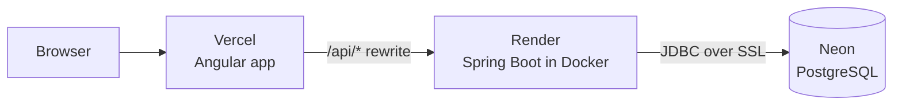

# FundTrack

FundTrack is a small mutual fund subaccounting app. A brokerage holds one combined (omnibus) account at each fund company, and FundTrack keeps track of how many units of each fund every individual client owns inside it. Advisors place buy and sell orders during the day, operations staff enter each fund's end-of-day price (NAV), and a "Process day" run prices and settles every pending order.

**Live demo:** https://fund-track-ibrahim.vercel.app

> The backend runs on a free Render instance that sleeps when idle. If the first page load hangs, give it a minute or two to wake up. After that it is fast.

Built with Angular 22, Spring Boot 4 (Java 25) and PostgreSQL.

<!-- Screenshots: add images to docs/screenshots/ and uncomment


-->

## Try it in a minute

The database starts with three clients (Sarah Chen, Kumar Patel, Maria Lopez) and three funds.

1. **Place order**: pick Sarah Chen, fund MPL100, Buy, $500. The order is saved as PENDING.
2. **Process day**: today's date is selected. Enter a NAV of `12.5` for MPL100 and save it. The pending order is listed under step 2.
3. Click **Process 1 pending order**. The result shows 1 settled.
4. **Clients > Sarah Chen**: her holdings now include 40 more units of MPL100 ($500 / $12.50), and the order shows as SETTLED.

To see a rejection, place a Sell for more units than a client holds, then process the day.

## How it works

Mutual funds are priced once a day, after the market closes. Every order placed during the day gets that day's price, which is called forward pricing. FundTrack follows the same flow:

1. Orders are placed during the day and saved as **PENDING**. Buys are entered in dollars, sells in units.
2. Operations enters each fund's NAV for the day.
3. **Process day** goes through that day's pending orders, oldest first:
   - Buy: units = amount / NAV (4 decimal places, half up)
   - Sell: amount = units x NAV (2 decimal places, half up)
   - A sell for more units than the client holds is **REJECTED**
   - Orders for a fund with no NAV yet stay **PENDING** and are picked up on the next run
4. Holdings are calculated from settled orders (buy units minus sell units) and valued at each fund's latest NAV.

## Architecture



- **Frontend (Angular):** standalone components, signals for state, Reactive Forms with validation that mirrors the backend, one service per backend controller. Vercel serves the built app and forwards `/api/*` to the backend, so the browser only talks to one origin and no CORS setup is needed.
- **Backend (Spring Boot):** thin REST controllers, business logic in services (`OrderProcessingService`, `HoldingService`), Spring Data JPA repositories. Built from a multi-stage Dockerfile and configured through environment variables, so no credentials are stored in the repo.
- **Database (PostgreSQL):** the schema is owned by Flyway migrations. Hibernate only validates that the entities match it.

## Design decisions

- **Orders are dated by the server.** The order request has no date field. Letting the caller choose the date would allow late trading (placing an order at a price that is already known).
- **Money and units use `BigDecimal`**, with explicit scale and rounding that match the database columns. No floating point.
- **Holdings are derived, not stored.** One query sums settled buy units minus sell units per fund, so there is a single source of truth.
- **Process day is all or nothing.** It runs in one transaction. A business rejection (an oversell) marks that order REJECTED and processing continues. An unexpected error rolls back the whole run. Settled and rejected orders are final, so running it twice is safe.
- **NAV history is append-only.** One price per fund per day, never overwritten, so every settled order can be traced back to the price it used.
- **Validation in layers.** The Angular forms give quick feedback, Bean Validation returns 400s, the controllers return 404/409 for missing or duplicate data, and database constraints (unique, check, foreign key) are the final guarantee.

## Testing

| | Tests | Tools |
|---|---|---|
| Backend | 47 | JUnit 5, Mockito, Testcontainers (real PostgreSQL 17), TestRestTemplate |
| Frontend | 26 | Vitest, Angular `HttpTestingController` |

`OrderProcessingService` was written test first. The integration tests run against a real PostgreSQL container instead of an in-memory database, which caught a bug the mocked unit tests could not: inside the Process day transaction, Hibernate flushes pending changes before running a query, so an early version of the sell check counted same-day sells twice. A dedicated integration test now covers it.

```bash
cd backend && ./gradlew test     # needs Docker running (Testcontainers)
cd frontend && npm test          # no backend needed
```

## Run it locally

Requirements: Docker, Java 25, Node 22 or later.

```bash
git clone https://github.com/IbrahimAjmal02/FundTrack.git
cd FundTrack

docker compose up -d                       # PostgreSQL on port 5432
cd backend && ./gradlew bootRun            # API on http://localhost:8080 (Flyway creates and seeds the tables)
cd frontend && npm install && npm start    # in a second terminal: app on http://localhost:4200
```

In development, `frontend/proxy.conf.json` forwards `/api` to `localhost:8080`, the same way Vercel does in production. `backend/requests.http` has example requests for every endpoint, including a full day from placing an order to settlement.

## API

| Method | Endpoint | Purpose |
|---|---|---|
| GET | `/clients` | List clients |
| POST | `/clients` | Create a client (409 if the subaccount number exists) |
| GET | `/clients/{id}` | One client |
| GET | `/clients/{id}/holdings` | Units and market value per fund |
| GET | `/funds` | List funds |
| GET | `/funds/{id}/nav?date=` | NAV history, or one date |
| POST | `/funds/{id}/nav` | Enter a NAV (409 if that date already has one) |
| POST | `/orders` | Place a buy or sell (saved as PENDING) |
| GET | `/orders?status=&clientId=` | List orders, optionally filtered |
| GET | `/orders/{id}` | One order |
| POST | `/orders/process?date=` | Price and settle the day's pending orders |

## Roadmap

- Kafka: publish an `OrderSettled` event for every settled order
- A second Spring Boot service that consumes those events and builds client statements in MongoDB
- Keycloak login with separate roles: advisors place orders, only operations can enter NAVs and process the day
- Cucumber scenarios for the main business rules and a GitHub Actions pipeline that runs all tests on every push
- Spring Boot Actuator health checks, and an idempotency key on order placement so a retried request cannot create a duplicate trade
